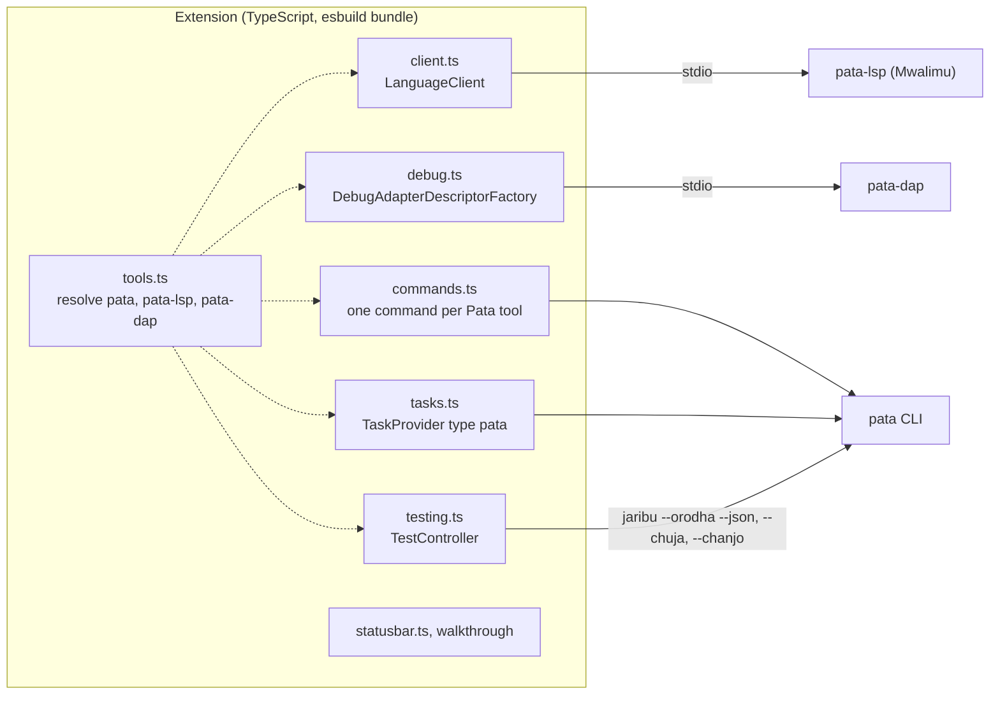

# Asili VS Code extension — Technical Requirements Document

As of 9 November 2026 · Victor Kaiuki

The extension stays a thin client: it resolves Pata tools, starts Mwalimu over LSP and `pata-dap`
over DAP, and turns every other Pata command into a command, task or test run. All language
behaviour stays in the Rust servers and the CLI. This document implements the
[Product Requirements Document](01-product-requirements.md) (VS-n).

## Architecture

Today all of this is one 143-line `src/extension.ts`. Split it into the modules above; each module
gets the tool path from `tools.ts`, the only place that knows how to find a binary.

## Tool resolution

One function, `resolveTool(name)`, used everywhere (VS-NFR-3):

1. The setting for that tool (`asili.serverPath`, `asili.cliPath`, `asili.debuggerPath`, and
   `asili.linterPath` for the standalone compatibility fallback).
2. The binary bundled in the extension's `bin/` (today `pata-lsp`; `pata-dap` is bundled per
   platform).
3. The tool on `PATH`.
4. Otherwise one notification (VS-7) naming the missing tool and linking to the install page.

The resolved paths are cached per session and shown by the command "Asili: Onyesha zana" (show
tools), which also prints each tool's version.

## Commands and tasks

- Every command in the PRD coverage table is registered in `package.json` `contributes.commands`
  with a `%key%` title and a `category` of `Asili`, so the palette reads "Asili: Jenga mradi".
- Most commands that run a CLI process use a VS Code task (`ProcessExecution`, cwd = the folder holding
  `pata.toml`, found by the same walk as `pata_config::find_project_root`), so output, exit codes
  and re-run come from VS Code for free.
- `contributes.taskDefinitions` adds type `pata` with properties `amri` (command) and `chagua`
  (flags); `tasks.ts` provides one task per common command so they appear under "Run Task".
- Build target and mode are a workspace-state setting (`asili.lengo`, `asili.namna`) shown in the
  status bar and passed as `--lengo` and `--namna`.
- `.asb` files get an explorer context menu "Tenda" running `pata tenda <file>`.

## Testing

- `TestController` discovers tests per project with `pata jaribu --orodha --json` (verified: returns
  `{"majaribio": [...]}`), on activation and when a `.as` file is saved.
- A run uses `pata jaribu --json --chuja <name>`. **CLI requirement:** today `--json` output is
  preceded by the tests' own printed output on stdout, so the result cannot be parsed reliably. The
  CLI must print test output on stderr, or inside the JSON, when `--json` is set (issue in the Asili
  repo).
- Coverage runs `pata jaribu --chanjo --json`, displays aggregate statement counts and test totals,
  and keeps the full JSON in an output channel. The CLI aggregates line numbers across source
  files, so the extension does not fabricate file-specific `FileCoverage` decorations. Add them
  only after the CLI reports file-qualified executed/total line sets.
- The Mwalimu code lens for tests stays, but calls the Testing API instead of a terminal.

## Debugger

- `contributes.debuggers` type `asili`, label "Asili", with launch configuration attributes
  `program` (default: the project in the workspace), `args`, `cwd`, and initial configurations and
  snippets.
- `DebugAdapterDescriptorFactory` returns a `DebugAdapterExecutable` for the resolved `pata-dap`.
  Bundle it per platform; `asili.debuggerPath` can override the bundled binary, with `PATH` as a
  fallback.
- `contributes.breakpoints` for language `asili`.
- **Supported by `pata-dap`** (since Asili `9e76e6f`): initialize, launch, setBreakpoints (also
  during a run), continue, next, stepIn, stepOut (by call depth), pause, stackTrace, scopes,
  variables, setVariable (scalar locals), evaluate (visible names and literals), restart and
  disconnect, with `stopped`, `exited`, `terminated` and `output` events. **Refused:** attach
  (only a debug build launched by the debugger can be debugged); goto, stepBack, reverseContinue,
  restartFrame, setExpression and terminate are not implemented. **Open gaps:** conditional
  breakpoints, a one-frame `stackTrace`, and the program's output sharing the DAP stdout stream.
  The extension reads the `initialize` capabilities and never advertises what the server refuses.

## CLI requirements this extension depends on

Work in the Asili repo, filed as issues there:

| Need | Today | Required |
| --- | --- | --- |
| Help for every command | Done: every command answers `--msaada` (Asili `776dcaf`) | — |
| Test JSON | Program output mixed into stdout before the JSON | Clean JSON on stdout when `--json` is set |
| Build diagnostics | `jenga` has no `--json`; unknown flags are passed through silently | `jenga --json` with diagnostics and artifact paths |
| Coverage format | `jaribu --chanjo --json` reports aggregate line counts and percentage | Per-file executed-line data before editor coverage decorations |
| Lint entry point | `pata kagua` when available; current standalone CLI has `pata-lint` | Detect `kagua`; otherwise use `asili.linterPath` |
| Format flags | Done: the `pata-fmt` binary is gone; `pata nadhifu --diff` is the only form | — |

## Localisation

- `package.nls.json` (English) and `package.nls.sw.json` (Swahili) for everything in `package.json`.
- `vscode.l10n.t()` for runtime strings, with `l10n/bundle.l10n.sw.json`.
- Swahili strings follow the project's `swahili-docs-and-errors` conventions; English is the
  translation.

## Build, test, release

- Keep esbuild bundling and `npm run build-lsp` (builds `pata-lsp` from an Asili checkout).
- Add integration tests with `@vscode/test-electron` against a fixture project: commands register,
  Test Explorer finds a test, a debug session stops at a breakpoint.
- CI (`ci.yml`) runs them on Linux; the existing word-list check against Asili stays.
- Publish with `vsce` to the Marketplace and `ovsx` to Open VSX from a tagged release, per
  platform (`--target linux-x64`, `darwin-arm64`, …) because of the bundled binaries.
