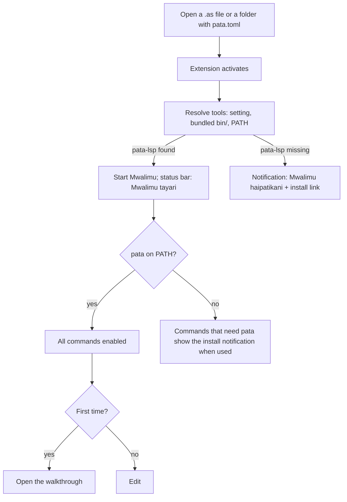

# Asili VS Code extension — App Flow

As of 7 November 2026 · Victor Kaiuki

A developer opens a folder, sees Mwalimu start in the status bar, and from then on reaches every
Pata tool from the Command Palette, CodeLens, the Test Explorer, Run Task or F5.

## Activation and tool check

## Surfaces

| Surface | What it offers |
| --- | --- |
| Command Palette (`Asili:` category) | Every command in the coverage table |
| Status bar item | Mwalimu state and build target; click: Jenga, Endesha, Jaribu, change target, show tools, restart Mwalimu |
| CodeLens on `kazi kuu` | Endesha · Tatua (debug) |
| CodeLens on `#[jaribio]` functions | Endesha jaribio · Tatua jaribio |
| CodeLens in `pata.toml` `[tegemezi]` | Ongeza tegemezi · Ondoa |
| Test Explorer | Every test, run, debug, run with coverage |
| Run Task | `pata: jenga`, `pata: jenga --tenda`, `pata: jaribu`, `pata: nadhifu`, `pata: thibitisha` |
| Run and Debug (F5) | Debug configuration `asili` |
| Explorer context menu | On `.asb`: Tenda. On a folder: Unda mradi mpya hapa |
| Editor title bar | Run button (Endesha) on Asili files |

## Flow 1: create and run a project

1. Palette → **Asili: Unda mradi mpya** (`pata njozi`).
2. Quick pick: application, library (`--maktaba`) or workspace (`--workspace`); then the name.
3. Folder picker for the location; the extension runs `pata njozi` there and offers to open the new
   folder.
4. In the new project, the editor opens `src/kuu.as`; CodeLens above `kazi kuu` shows **Endesha**.
5. Endesha runs `pata jenga --tenda` as a task; output appears in the terminal panel.

## Flow 2: edit loop

1. Typing shows diagnostics from Mwalimu (Swahili messages, codes), hover, completion and
   signature help.
2. Save formats the file when `editor.formatOnSave` is on (LSP formatting, same rules as
   `pata nadhifu`).
3. Lint findings from `pata-lint` appear in Problems; quick fixes come from Mwalimu code actions.
4. Rename, go to definition, find references, symbols and inlay hints work across the project.

## Flow 3: test

1. The Test Explorer lists tests found by `pata jaribu --orodha --json`.
2. Run one test (CodeLens or explorer): `pata jaribu --json --chuja <name>`; pass or fail shows inline
   with the message.
3. **Run with coverage**: `pata jaribu --chanjo`; covered lines are marked in the editor.

## Flow 4: debug

1. Set a breakpoint in a `.as` file; press F5 (no `launch.json` needed: the default configuration
   debugs the project's `kuu`).
2. `pata-dap` launches; execution stops at the breakpoint.
3. Call stack, scopes and variables appear; Continue runs to the next breakpoint.
4. v2: step over, step in, step out, pause and the debug console (evaluate) once `pata-dap` supports
   them. Until then those buttons stay disabled because the server does not advertise them.

## Flow 5: project maintenance

- **Ongeza tegemezi**: quick pick for source (registry name, `--git` URL, `--tawi` branch,
  `--toleo` version), then `pata ongeza`.
- **Ondoa tegemezi**: pick from the current `[tegemezi]`, then `pata ondoa`.
- **Thibitisha mradi**: `pata thibitisha`; results in Problems.
- **Nadhifisha mradi**: `pata nadhifu` on the whole project; **Kagua mpangilio** runs `--kagua` and
  lists unformatted files.
- **Fungua REPL**: a terminal running `pata repl`.
- **Endesha kwa ufuatiliaji**: `pata jenga --tenda --fuatilia=json:<file>`, then the trace opens as a
  tree view (or `pata fuatilia <file>` in a terminal until the tree view lands).

## Error states

| Situation | What the user sees |
| --- | --- |
| `pata` not found | One notification per session: which tool is missing, "Sakinisha" opens the install page, "Weka njia" opens the setting |
| Mwalimu crashes | Status bar turns to a warning; "Anzisha upya Mwalimu" restarts it |
| No `pata.toml` above the file | Single-file commands still work (`pata jenga <file>`); project commands explain that a project is needed and offer "Unda mradi mpya" |
| Debug request not supported by `pata-dap` | Button disabled, never an error dialog |
| Test JSON cannot be parsed | Test marked errored with the raw output attached |
