# Asili VS Code extension — Implementation Plan

As of 7 November 2026 · Victor Kaiuki

Five phases. Phase 0 is a one-line bug fix that can ship today. Phases 2 and 3 depend on a few CLI
and `pata-dap` changes in the Asili repo, listed as their own tasks.

## Roadmap

```mermaid
flowchart LR
  p0["0 · Fix Run Test<br/>--chuja<br/>task 1"]
  p1["1 · Structure<br/>tools.ts, modules, l10n<br/>tasks 2–5"]
  g1{{"All tools resolve<br/>Show tools lists them"}}
  p2["2 · Every tool<br/>commands, tasks, tests<br/>tasks 6–13"]
  g2{{"Coverage table<br/>100% of v1 rows"}}
  p3["3 · Debugger<br/>debug type asili<br/>tasks 14–17"]
  g3{{"Breakpoint stops<br/>variables shown"}}
  p4["4 · Publish<br/>walkthrough, icons, stores<br/>tasks 18–22"]
  g4{{"v1 on Marketplace<br/>and Open VSX"}}
  p0 --> p1 --> g1 --> p2 --> g2 --> p3 --> g3 --> p4 --> g4
```

## Task tracker

| # | Task | Repo | Covers | Phase | Status |
| --- | --- | --- | --- | --- | --- |
| 1 | Change Run Test to `pata jaribu --chuja` | asili-vscode | VS-1 | 0 | Not started |
| 2 | Split `extension.ts` into `tools`, `client`, `commands`, `tasks`, `testing`, `debug`, `statusbar` | asili-vscode | VS-NFR-3 | 1 | Not started |
| 3 | `resolveTool()` plus "Show tools" command and missing-tool notification | asili-vscode | VS-7, VS-NFR-3 | 1 | Not started |
| 4 | Localisation: `package.nls.json`, `package.nls.sw.json`, `l10n/` | asili-vscode | VS-NFR-2 | 1 | Not started |
| 5 | Status bar item with Mwalimu state and build target | asili-vscode | VS-6 | 1 | Not started |
| 6 | Every command in the coverage table (build, run, target, trace, format, lint, verify, new project, deps, REPL, workspace info) | asili-vscode | VS-2 | 2 | Not started |
| 7 | `pata` task type and provider | asili-vscode | VS-4 | 2 | Not started |
| 8 | Test Explorer via `jaribu --orodha --json` and `--chuja` | asili-vscode | VS-3 | 2 | Not started |
| 9 | Coverage view from `jaribu --chanjo` | asili-vscode | VS-10 | 2 | Not started |
| 10 | Every `pata` command answers `--msaada` | Asili | VS-2 | 2 | Not started |
| 11 | Clean JSON from `jaribu --json`; machine format for `--chanjo` | Asili | VS-3, VS-10 | 2 | Not started |
| 12 | `jenga --json` and an error on unknown flags | Asili | VS-NFR-4 | 2 | Not started |
| 13 | Trace tree view from `--fuatilia=json` | asili-vscode | VS-11 | 2 | Not started |
| 14 | Debug type `asili`, launch configurations, breakpoints contribution | asili-vscode | VS-5 | 3 | Not started |
| 15 | Bundle or resolve `pata-dap`; decide bundling | asili-vscode | VS-5 | 3 | Not started |
| 16 | `pata-dap`: next, stepIn, stepOut, pause | Asili | VS-12 | 3 | Not started |
| 17 | `pata-dap`: evaluate, setVariable, restart | Asili | VS-12 | 3 | Not started |
| 18 | Walkthrough (five steps) with screenshots | asili-vscode | VS-8 | 4 | Not started |
| 19 | Extension and file icons from the vector logo | asili-vscode | Design Brief | 4 | Not started |
| 20 | Integration tests with `@vscode/test-electron` in CI | asili-vscode | VS-NFR-6 | 4 | Not started |
| 21 | Marketplace README (Swahili first) and GIF | asili-vscode | Design Brief | 4 | Not started |
| 22 | Publish per platform to Marketplace and Open VSX | asili-vscode | Scope | 4 | Not started |

Tasks 16 and 17 are v2 in the PRD; they sit in Phase 3 so the debugger work stays together, but v1
can ship without them.

## Decisions needed

| Decision | Blocks | Recommendation |
| --- | --- | --- |
| Bundle `pata-dap` in the extension | Task 15 | Yes, same as `pata-lsp`, per platform |
| Publisher and namespace | Task 22 | One publisher for the Asili-Programming org |
| `pata lint` subcommand | Task 6 (lint commands) | Yes; keeps one CLI for the extension to call |

## Launch checklist

- [ ] Every v1 row of the coverage table has a working surface, checked by hand on a fixture project.
- [ ] Run Test, Test Explorer and coverage work on Linux, macOS and Windows.
- [ ] F5 stops at a breakpoint and shows variables.
- [ ] Every string shows in Swahili with VS Code set to Swahili, and in English otherwise.
- [ ] The wiki's Editor Support page lists every command and setting.
- [ ] Published to both stores; the install link on the website works.
