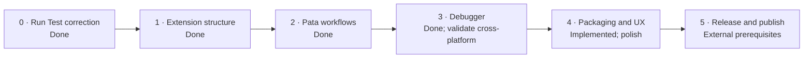

# Asili VS Code extension — Implementation Plan

As of 10 November 2026 · Victor Kaiuki

The original five implementation phases are complete for the local v0.5.0 implementation, except
for explicitly tracked validation, documentation/media, and publishing work below. This plan is
updated to reflect the actual code rather than the original proposed file layout.

## Roadmap

## Task tracker

| # | Task | Repo | Covers | Phase | Status |
| --- | --- | --- | --- | --- | --- |
| 1 | Change Run Test to `pata jaribu --chuja` | asili-vscode | VS-1 | 0 | Done |
| 2 | Split extension logic into tool resolution, commands, tasks, testing, tracing and status modules | asili-vscode | VS-NFR-3 | 1 | Done |
| 3 | Tool paths, Show Tools command, missing-tool notifications, and lint CLI compatibility fallback | asili-vscode | VS-7, VS-NFR-3 | 1 | Done |
| 4 | Localisation: `package.nls.json`, `package.nls.sw.json`, `l10n/` | asili-vscode | VS-NFR-2 | 1 | Done |
| 5 | Status bar item with Mwalimu state, actions and build target | asili-vscode | VS-6 | 1 | Done |
| 6 | Commands for common Pata workflows: build, run, trace, format, lint, verify, project, deps, REPL and artifacts | asili-vscode | VS-2 | 2 | Done |
| 7 | `pata` task type and provider | asili-vscode | VS-4 | 2 | Done |
| 8 | Test Explorer via `jaribu --orodha --json` and `--chuja` | asili-vscode | VS-3 | 2 | Done |
| 9 | Coverage command with machine-readable summary and user-facing results | asili-vscode | VS-10 | 2 | Done; Pata reports aggregate statement coverage, surfaced in a summary and output channel |
| 10 | Every `pata` command answers `--msaada` | Asili | VS-2 | 2 | Done (Asili `776dcaf`) |
| 11 | Clean JSON from `jaribu --json`; machine format for `--chanjo` | Asili | VS-3, VS-10 | 2 | Implemented on `feature/vscode-jenga-json`; CLI integration test added |
| 12 | `jenga --json` and an error on unknown flags | Asili | VS-NFR-4 | 2 | Implemented on `feature/vscode-jenga-json`; CLI tests added |
| 13 | Trace tree view from a decoded binary trace | asili-vscode | VS-11 | 2 | Done |
| 14 | Debug type `asili`, launch configurations, breakpoints contribution | asili-vscode | VS-5 | 3 | Done |
| 15 | Build and bundle `pata-dap` per platform; support `asili.debuggerPath` override and `PATH` fallback | asili-vscode | VS-5 | 3 | Implemented; updated cross-platform CI run pending |
| 16 | `pata-dap`: next, stepIn, stepOut, pause, and emit stopped/continued events | Asili | VS-12 | 3 | Implemented on `feature/vscode-jenga-json`; evaluator/DAP tests and VS Code host smoke test pass |
| 17 | `pata-dap`: evaluate, setVariable, restart | Asili | VS-12 | 3 | Done; evaluator/DAP integration test verifies local evaluation, numeric mutation, and restart |
| 18 | Walkthrough (five steps) | asili-vscode | VS-8 | 4 | Done |
| 19 | Extension icon and language file icon, sourced from playground mark | asili-vscode | Design Brief | 4 | Implemented; manifest tests verify paths, dimensions, and theme variants |
| 20 | Integration tests with `@vscode/test-electron` in CI | asili-vscode | VS-NFR-6 | 4 | Implemented; debugger smoke test added, full host test pending |
| 21 | Marketplace README (Swahili first) | asili-vscode | Design Brief | 4 | Implemented; demo GIF and walkthrough screenshots remain |
| 22 | Publish per platform to Marketplace and Open VSX | asili-vscode | Scope | 4 | Blocked on publisher credentials and explicit release authorization |
| 23 | Add Explorer/editor actions, complete the status-bar action menu, and add trace-view guidance | asili-vscode | Design Brief | 4 | Done |
| 24 | Surface the `jaribu --chanjo --json` aggregate summary and raw report in VS Code | asili-vscode | VS-10 | 4 | Done |

The original plan incorrectly marked both debugger tasks complete based on an earlier commit.
Verification found that stepping and pause requests were no-ops and breakpoint stops were not
reported to the DAP client. Tasks 16 and 17 now implement these controls and the tested evaluate,
numeric/boolean local mutation, and restart paths. Attach, conditional breakpoints, multi-frame
stack traces, and debug-console output remain outside this v1 scope. The current CLI JSON work is
tracked on `feature/vscode-jenga-json`; `pata kagua` compatibility fallback is implemented.

## Decisions needed

The implementation choices are settled. Remaining external actions are a successful CI run on all
three operating systems, a manual Swahili/English and workflow pass in VS Code, publishing
credentials for the `asili` publisher and Open VSX, and authorization to publish.

## Launch checklist

- [x] Core command, task, Testing API, trace, and breakpoint/step debugger surfaces are implemented.
- [x] Complete the scoped VS-12 debugger support: evaluate, setVariable, restart.
- [x] Clean test JSON and structured build JSON are implemented in the Asili feature branch.
- [x] Platform-targeted VSIX packaging and playground-derived extension/file icons are implemented.
- [x] Run targeted CLI and extension tests, including a real debugger breakpoint/locals session.
- [ ] Obtain successful Linux, macOS, and Windows build/package CI results for these changes.
- [ ] Manually verify the principal workflows and Swahili/English UI in VS Code.
- [ ] Update and publish the wiki's Editor Support page after the docs are final.
- [ ] Publish to Marketplace and Open VSX once credentials and release authorization are available.
